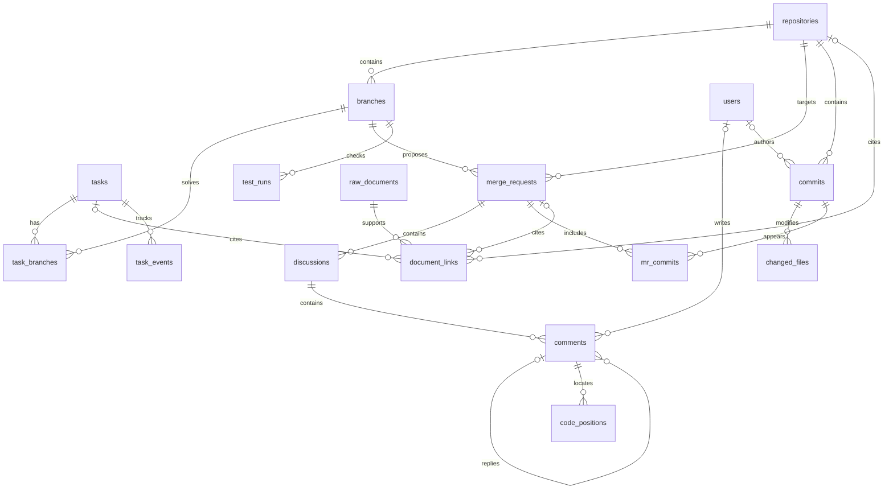

# Структура базы данных

## Ограничения целостности

* Репозиторий определяется каноническим URL. Название может совпасть у нескольких репозиториев. В таком случае CLI принимает URL.
* Ветка определяется целевым репозиторием, URL исходного репозитория и именем ветки. Для ветки собственного репозитория указывается его же URL. Связь задачи и ветки имеет составной первичный ключ.
* Номер MR уникален в пределах целевого репозитория. У задачи может быть внешний номер в определённом источнике. Задача без внешнего номера доступна по локальному ID.
* Обсуждения принадлежат MR, комментарии принадлежат обсуждению. Автор может быть неизвестен. Позиция замечания хранит путь, ревизию и строки.
* SHA коммита уникален в репозитории. Таблица `mr_commits` связывает коммит с несколькими MR. Файлы и diff принадлежат коммиту.
* Таблицы `repository_dependencies`, `task_dependencies` и `mr_dependencies` хранят направленные пары. Ссылка на себя запрещена.
* Оригинал хранится в `raw_documents` как текст UTF-8 со всеми исходными пробелами и переводами строк. Ключ повторного импорта учитывает тип документа, формат, источник и SHA-256 исходного текста. Связь в `document_links` указывает ровно на одну сущность. Удаление сущности сохраняет оригинал.
* Внешние ключи включаются при каждом подключении. Записи, на которые ссылается история работы, защищены от удаления. Зависимые строки принадлежности удаляются каскадно.
* Виртуальная таблица `search_index` содержит поисковые копии текста репозиториев, задач, MR, комментариев и оригиналов. Индекс обслуживают триггеры SQLite. Версию схемы хранит Alembic.

## Миграция 0002

`mr_commits` содержит текущий известный набор. `mr_revisions` и `revision_commits` сохраняют состав каждого полученного снимка и ссылку на оригинал. Набор из 0001 получает отметку `legacy` и неизвестную дату. Для замены текущего состава передайте `"revision": {"complete": true}` и явный массив `commits`. Пустой массив очищает текущий состав. Частичный импорт добавляет известные коммиты.

`task_merge_requests` хранит связи задач и MR, включая восстановленные из веток. Новые события `task_events` содержат время наблюдения в UTC, источник, предыдущее и новое значения. Импортированные статусы дополнительно сохраняются в `external_status`. Неоднозначные исторические даты сохраняются в `legacy_values`; в нормализованном поле сущности остаётся NULL. Для новых дат требуется ISO 8601 с часовым поясом.

## Миграция 0003

У MR поля номера и ссылки на ветку допускают NULL. Внешняя уникальность сохраняется для известных номеров. Внешние ключи, индексы и FTS-триггеры восстанавливаются при перестроении таблиц. Перед фиксацией миграции проверяется целостность ссылок во всей базе. У комментариев и обсуждений ключи локального происхождения записываются отдельно в `local_key`.

`document_extractions` хранит версии предложений с моделью, версией промпта, датой, JSON-полями и статусом `pending`, `confirmed` или `superseded`. Ссылка ведёт на неизменённый `raw_documents`. Отсутствующие внешние даты сущностей остаются NULL. Время сохранения оригинала, извлечения и событий каталога фиксируется отдельно.
